# برومت تصميم: إعادة بناء أسلوب واجهة تطبيق Apple Support

> الصق هذا الملف في أداة ذكاء اصطناعي للتصميم أو البرمجة (مع مجلد `images/` أو الصور المرفقة). المصدر: تسجيل شاشة حقيقي لتطبيق Apple Support على iOS، الوضع الفاتح، واجهة عربية (RTL)، جهاز بعرض 428 نقطة (مثل iPhone 15 Plus) بمقياس 3x. اللقطات مأخوذة من المقطع نفسه.

---

أنت مصمم ومطوّر واجهات متخصص في نظام iOS (خصوصاً iOS 26 وLiquid Glass). مهمتك أن تعيد بناء واجهة بنفس أسلوب تطبيق **Apple Support** (دعم Apple) بدقة عالية: الشكل الثابت، نظام الألوان، الخطوط، المسافات، الزوايا، الأيقونات، البار السفلي، الهيدر، الكروت والقوائم، وأنماط الحركة والتفاعل، ودعم RTL.

الهدف ليس نسخ محتوى Apple أو علامتها، بل تطبيق **نظام التصميم** هذا على المنتج الذي أطلبه. استخدم بيانات وهمية للأسماء والبريد وأرقام الهواتف؛ لا تنسخ أي بيانات شخصية ظاهرة في الصور. الدائرة الحمراء مع الوقت في أعلى الشاشات هي مؤشر تسجيل الشاشة، وليست جزءاً من التطبيق — لا ترسمها.

اعتمد القيم المقاسة من اللقطات أدناه. حيث أذكر لوناً نظامياً متوقعاً، فذلك لأن تسجيل الشاشة قد يزيح اللون قليلاً؛ ابدأ بالقيمة المقاسة، ويحق لك استخدام اللون النظامي الأقرب في iOS إذا كنت تطوّر للتطبيق الأصلي.

---

## 1. الهوية العامة

- نظافة شديدة، كثير من المساحات الفارغة، تباين واضح بين الأبيض والرمادي الفاتح.
- لا ظلال ثقيلة على الكروت أو الصفوف. الظل الناعم يظهر فقط على العناصر العائمة: كبسولة الحساب/البحث، البار السفلي، أزرار الإغلاق الدائرية، أزرار الرجوع والبحث في صفحات التفاصيل، والأزرار الدائرية فوق الخريطة.
- زوايا مدورة بوضوح (ليست حادة وليست دوائر كاملة إلا في الأزرار الدائرية والكبسولات).
- أسلوب iOS 26: **Liquid Glass** — البار السفلي وكبسولة الهيدر زجاجيان شبه شفافين مع `backdrop-filter`، ويعكسان ما وراءهما (يتضح هذا جداً فوق الخريطة).
- صفحتان أساسيتان للخلفية:
  - **أبيض نقي `#FFFFFF`:** تبويب «الدعم» (الصفحة الرئيسية) وبعض الأوراق (Sheets) ذات العنوان الكبير والقائمة البسيطة.
  - **رمادي فاتح `#F0EFF5`:** تبويب «النشاط»، صفحات تفاصيل الجهاز، وأوراق الإعدادات/التغطية/الاشتراكات/الملف الشخصي (أسلوب *inset grouped*).
- المحتوى مرتب في أقسام بعناوين عريضة يمين (RTL)، وكروت مستقلة أو قوائم داخل بطاقة بيضاء واحدة حسب السياق.
- الأرقام اللاتينية والعربية-الهندية تظهر معاً حسب السياق (الأسعار والتواريخ بالعربية-الهندية في شاشة الاشتراكات).

---

## 2. نظام الألوان

القيم التالية **مقيسة بالبكسل من اللقطات** (PIL، وسيط اللون في رقعة مسطحة). بجانب بعضها أذكر اللون النظامي الأقرب في iOS، لأن ضغط فيديو التسجيل قد يغمّق أو يزيح اللون قليلاً.

| الدور | القيمة المقاسة | الأقرب نظامياً (مرجع) |
|---|---|---|
| خلفية صفحة «الدعم» | `#FFFFFF` | `systemBackground` |
| خلفية مجمّعة / نشاط / تفاصيل / أوراق | `#F0EFF5` | `systemGroupedBackground` (`#F2F2F7`) |
| تعبئة كرت الجهاز أو أداة الدعم على خلفية بيضاء | `#F0EFF5` | نفس الرمادي الفاتح |
| بطاقة القائمة البيضاء فوق الخلفية المجمّعة | `#FFFFFF` | `secondarySystemGroupedBackground` |
| النص الأساسي | `#000000` | `label` |
| النص الثانوي / الشروح / التسميات الفرعية | `#7A797F` | `secondaryLabel` (`#8E8E93`) |
| فاصل الصفوف (خط رفيع 1pt) | `#E5E5E5` | قريب من `separator` / `#E5E5EA` |
| زر أساسي ممتلئ (السماح) | `#006EFE` | `systemBlue` (`#007AFF`) |
| نص/روابط باللون الأزرق (إظهار التفاصيل، روابط الملف الشخصي) | `#0F6EFC` إلى `#0F6EF8` | `systemBlue` |
| أيقونة ولون التبويب المحدد | `#0063F5` | `systemBlue` |
| زجاج البار السفلي (جسم الكبسولة) | `#FAF9FD` | أبيض زجاجي شبه معتم |
| تظليل كبسولة التبويب المحدد | `#E6E5E9` | رمادي فاتح داخل البار |
| كرت جهاز في حالة الضغط | `#CECDD3` | `#F0EFF5` مع تغميق يعادل تقريباً طبقة أسود بشفافية ~14% |
| نص انتهاء الصلاحية | `#EF3438` | `systemRed` (`#FF3B30`) |
| مسار مفتاح التبديل وهو مغلق | `#BDBCBE` | رمادي متوسط، والمقبض أبيض |
| أيقونة حالة الفراغ (دائرة الساعة) | `#7A797F` | نفس الرمادي الثانوي |
| زر ثانوي (ليس الآن) | `#FDFDFD` تقريباً أبيض، مع نص أسود | — |
| علامة الإغلاق X | `#181818` تقريباً أسود | — |

لا تستخدم أسوداً خالصاً في الخلفيات، ولا تدرج ألوان عشوائية خارج هذه المجموعة إلا في أيقونات الخدمات (ألوان علامات Apple والمنتجات) وكرت «موصى به» المتدرج.

---

## 3. الخطوط والأحجام

- الخط النظامي: **SF Arabic** للنصوص العربية، و**SF Pro** للاتينية والأرقام. الوزن الثقيل للعناوين الكبيرة (Heavy / Bold)، والعريض للعناوين الفرعية، والمنتظم للنصوص والشروح.
- المقاسات التالية مقاسة من ارتفاع حبر الحروف في اللقطات (بعرض منطقي 428pt @3x)، وهي قريبة من مقياس Dynamic Type الافتراضي في iOS:

| الأسلوب | الحجم التقريبي | الوزن | الاستخدام |
|---|---|---|---|
| Large Title | ~34pt (حبر مقاس 34–36pt) | Heavy / Bold | «الدعم»، «النشاط الحديث»، عناوين الأوراق الكبيرة مثل «مزيد من المنتجات» و«التحقق من التغطية» و«أجهزتي» و«خدماتي» |
| Section / Title 2 | ~22pt (حبر مقاس ~25–26pt) | Bold | «أجهزتي»، «أدوات الدعم»، عناوين الأقسام |
| Headline / Title 3 | ~20–22pt | Bold | عنوان حالة الفراغ، اسم الجهاز في صفحة التفاصيل (~21pt) |
| Body | 17pt (حبر مقاس ~16.7pt) | Regular أو Semibold للاسم | صفوف القوائم، تسميات أدوات الدعم، أسماء الأجهزة في الكروت |
| Callout / Footnote | ~13–15pt | Regular | الشروح الرمادية تحت اسم الجهاز («هذا iPhone 13 Pro Max»، «مقترن»)، نص المساعدة، وصف حالة الفراغ |
| Caption | ~10–11pt | Regular / Medium | تسميات البار السفلي، ووسم «الحل» فوق كرت التوصية |
| عنوان الشريط المطوي | ~17pt Semibold | عند التمرير يتحول العنوان الكبير «الدعم» إلى عنوان صغير ثابت في شريط التنقل |

- محاذاة النص العربي إلى اليمين. الأرقام قد تظهر بالصيغة العربية-الهندية (١٢٣) أو اللاتينية حسب السياق.
- لا تستخدم خطوطاً بعيدة عن عائلة San Francisco / SF Arabic (لا serif، لا خطوط عرضية زخرفية).

---

## 4. المسافات والزوايا

الجهاز المرجعي: **428pt** عرضاً.

- الهامش الأفقي للمحتوى: **~20pt** من الحافتين.
- المسافة بين كروتي جهاز متجاورين: **10pt**. كرت الجهاز: تقريباً **189 × 156pt**.
- كرت أداة الدعم: ارتفاع **64pt**، وعرض يملأ الهامشين (~387pt)، والمسافة الرأسية بين كرت وآخر **10pt**.
- نصف قطر كروت الأجهزة والأدوات: مقاس **~18pt** (قريب من 16–20pt). ليست كبسولة كاملة.
- نصف قطر الزوايا العليا للورقة (modal sheet): كبير، مقاس **~36–40pt**. الورقة شبه ملء الشاشة.
- صفوف قائمة «مزيد من المنتجات»: ارتفاع الصف **~54pt**، فاصل شعرة 1pt بلون `#E5E5E5`.
- الأزرار الأساسية والثانوية في شاشة «تحسين البحث»: كبسولة كاملة الاستدارة، عرض كبير (حوالي 350pt، بهامش جانبي ~39pt)، وارتفاع يبدو قريباً من 50pt.
- أزرار الإغلاق والرجوع والبحث في صفحات التفاصيل: دوائر بيضاء مع ظل ناعم، الأيقونة داخلها ~16pt، ومنطقة الضغط أكبر (~44pt).
- لا تستخدم ظلاً على كروت المحتوى أو صفوف القوائم.

---

## 5. البار السفلي

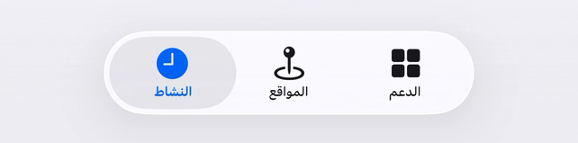

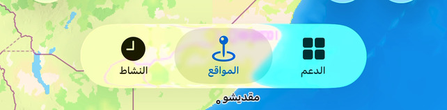

- كبسولة عائمة من **Liquid Glass**، لا تلتصق بأطراف الشاشة ولا بالأسفل تماماً (يبقى مؤشر المنزل تحتها).
- ثلاثة تبويبات من اليمين إلى اليسار في RTL: **الدعم** (شبكة أربع مربعات)، **المواقع** (دبوس)، **النشاط** (ساعة/سهم وقت).
- الأيقونات من أسلوب **SF Symbols**، مملوءة (filled).
- التبويب غير المحدد: أيقونة سوداء وكتابة سوداء.
- التبويب المحدد: أيقونة ونص بالأزرق `#0063F5`، وخلفه **كبسولة رمادية فاتحة `#E6E5E9`** داخل البار (ليست مجرد تغيير لون الأيقونة).
- فوق الخريطة يتضح أن البار شبه شفاف (`backdrop-filter`) ويلتقط ألوان المشهد تحته.
- التبديل بين التبويبات **فوري** في شريط التبويب؛ المحتوى يُستبدل مباشرة (الخريطة تبدأ بشبكة بلاط فاتحة ثم تُحمَّل القطع).

---

## 6. الهيدر

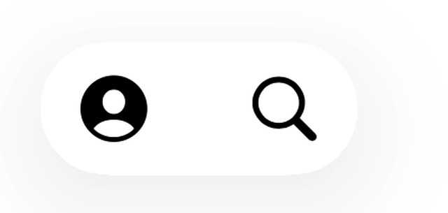

- في الصفحة الرئيسية لتبويب الدعم: العنوان الكبير «الدعم» محاذى لليمين.
- أيقونتا **الحساب** (شخص داخل دائرة) و**البحث** (عدسة) تجتمعان في **كبسولة بيضاء عائمة** أعلى اليسار، بظل ناعم جداً، وأيقونات SF Symbols سوداء مملوءة.
- هذه الكبسولة **تبقى ثابتة** أثناء التمرير. العنوان الكبير يُطوى إلى عنوان صغير في شريط التنقل (يظهر «الدعم» في الأعلى بعد التمرير).
- في صفحات التفاصيل المدفوعة (Push): لا توجد كبسولة الحساب. بدلاً منها زرّان دائريان أبيضان بظل ناعم: **رجوع** (سهم للأسفل/لليمين، أي اتجاه الرجوع في RTL) في الأعلى يميناً، و**بحث** في الأعلى يساراً.

---

## 7. الكروت والقوائم

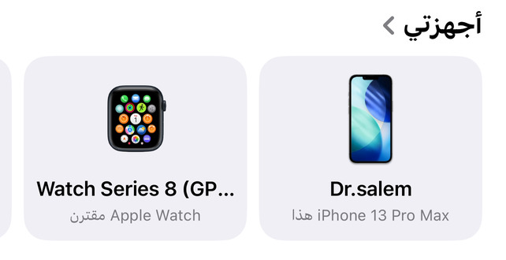

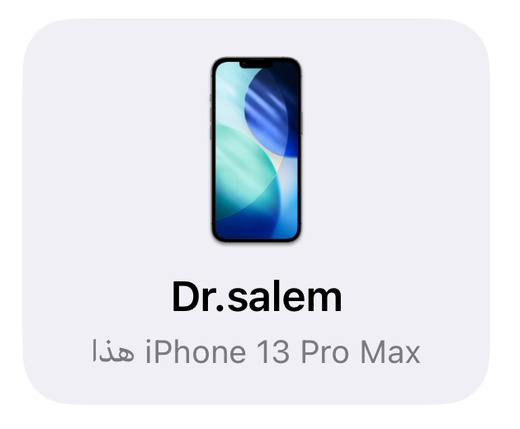

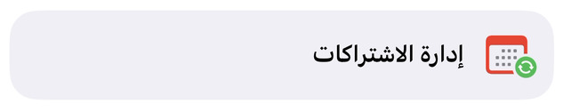

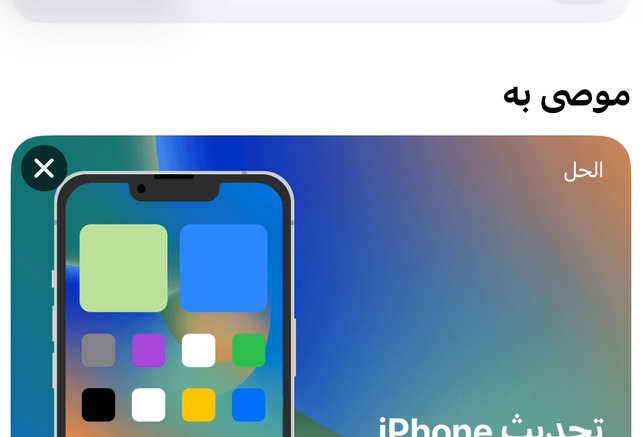

ثلاثة أنماط رئيسة:

**أ) كروت مستقلة على خلفية بيضاء (الصفحة الرئيسية)**
- كل أداة دعم في **كرت مستقل** رمادي `#F0EFF5`، ليست قائمة واحدة مجمّعة. الأيقونة على اليمين (جهة البداية في RTL)، النص بجانبها، **بدون سهم كشف (chevron)**.
- أجهزة المستخدم: دوّار أفقي من عمودين، مع ظهور جزء بسيط من الكرت السابق/التالي عند الحافة. أعلى الكرت رسمة المنتج الحقيقية، ثم اسم عريض، ثم سطر رمادي.
- خدماتي: كروت مربعة/مستطيلة في صف من عمودين (أيقونة الخدمة داخل مربع أبيض صغير مدور، الاسم، وقد يظهر شرح استخدام مثل iCloud+).
- مزيد من المنتجات: دوّار أفقي من صفين (كروت كبسولية أفقية فيها اسم المنتج وأيقونته).

**ب) قائمة داخل ورقة بيضاء (مثل مزيد من المنتجات، أجهزتي، خدماتي)**
- عنوان كبير يمين، زر X دائري أعلى اليسار عادةً.
- صفوف بفواصل شعرية `#E5E5E5`. الأيقونة أو صورة المنتج على اليمين. بعض هذه القوائم بلا سهم كشف (مزيد من المنتجات، أجهزتي).

**ج) قائمة مجمّعة Inset Grouped (تفاصيل الجهاز، التغطية، الاشتراكات، الملف الشخصي)**
- خلفية `#F0EFF5`، وبطاقة بيضاء واحدة كبيرة الزوايا تضم الصفوف.
- سهم كشف `<` على اليسار (جهة النهاية في RTL).
- في تفاصيل الجهاز: أيقونات موضوعات الدعم ملونة بأسلوب SF Symbols على اليمين.
- في الاشتراكات: أيقونة التطبيق يميناً، الاسم والوصف وتاريخ التجديد (رمادي، أو أحمر إذا قاربت الصلاحية)، والسعر مع السهم يساراً. تجميع تحت عناوين «نشطة» و«غير نشطة»، مع إجراء «فرز» أزرق.

عناوين الأقسام القابلة للفتح (أجهزتي، خدماتي، مزيد من المنتجات) تظهر مع **سهم صغير بجانب العنوان** يدل على أن القسم نفسه يفتح ورقة أو صفحة.

---

## 8. الأيقونات

فرّق بوضوح بين ثلاثة أنواع، ولا تخلط بينها:

1. **رسوم المنتجات الحقيقية (product renders):** أجهزة Apple مصوّرة بواقعية (Apple Watch، iPhone، AirPods، iPad) في كروت الأجهزة وصفحات التفاصيل. خلفية الكرت رمادية فاتحة ومحايدة، والجهاز في الوسط.
2. **أيقونات SF Symbols:** الحساب، البحث، الرجوع، الإغلاق، تبويبات البار، أسهم الكشف، أيقونات موضوعات الدعم (موجة صوت زرقاء، بطارية خضراء، مفتاح أحمر، قفل، قلب أداء…)، أيقونة حالة الفراغ، ومؤشرات التحميل (spinner مروحي).
3. **أيقونات تطبيقات وخدمات ملونة:** مربعات مدورة بألوان العلامة (App Store، Apple Music، Apple TV، iCloud، Apple One، شعار Apple على خلفية حمراء لـ AppleCare، أيقونات الاشتراكات الخارجية…).

أيقونات أدوات الدعم على الصفحة الرئيسية: مربعات/أشكال ملونة صغيرة على يمين الكرت (تقويم مع شارة، ورقة وقلم أزرق، تفاحة AppleCare).

---

## 9. الشاشات بالترتيب

### 9.1 إطلاق التطبيق

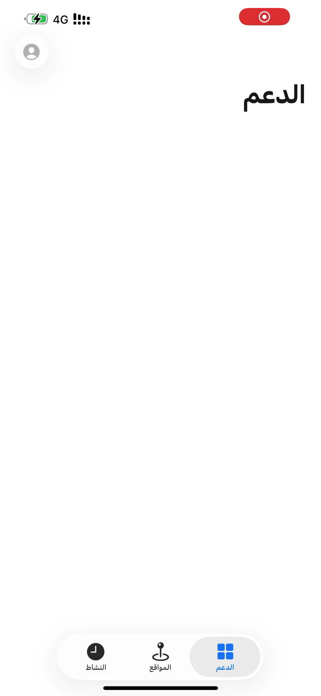

شاشة بيضاء، يظهر العنوان الكبير «الدعم» والبار السفلي فوراً. كبسولة الحساب قد تظهر أولاً بأيقونة واحدة قبل اكتمالها. المحتوى (الأجهزة والأدوات) يصل بعدها؛ لا تستخدم شاشة شعار كاملة كبديل إلا إذا طلب ذلك.

### 9.2 تبويب الدعم — الصفحة الرئيسية

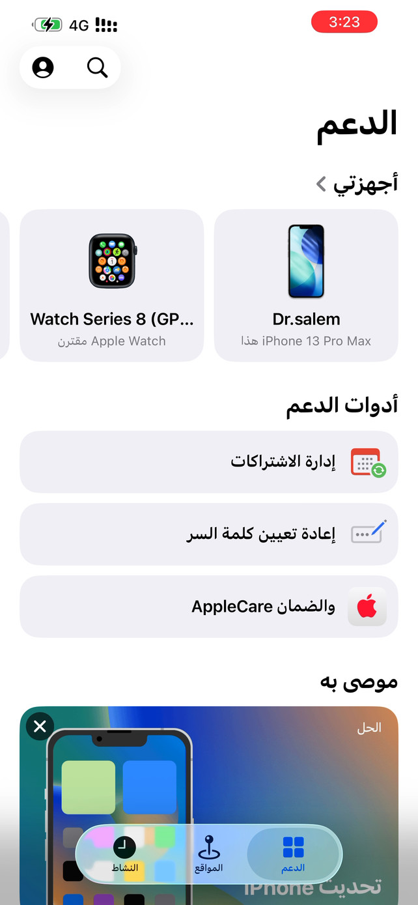

العناصر من الأعلى: كبسولة الحساب/البحث ثابتة يساراً، العنوان الكبير «الدعم» يميناً، قسم «أجهزتي» مع سهم، دوّار كروت الأجهزة، قسم «أدوات الدعم»، كروت الأدوات المستقلة، قسم «موصى به»، ثم كرت التدرج الذي قد يختبئ جزئياً خلف البار السفلي.

### 9.3 تبويب الدعم بعد التمرير

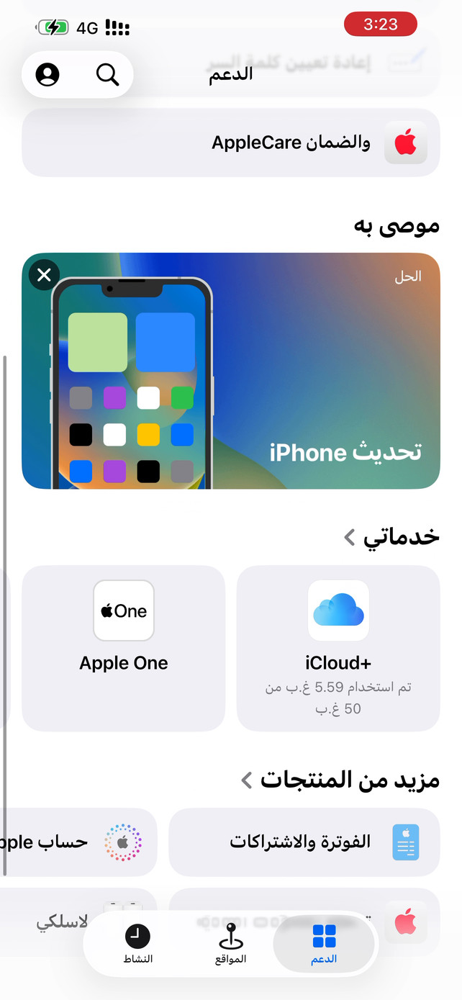

- الكبسولة تبقى في مكانها، و«الدعم» يصير عنوان شريط.
- كرت «موصى به»: عرض كامل، زوايا كبيرة، تدرج أزرق/أخضر/تيل، صورة iPhone، وسم صغير «الحل» أعلى اليمين، زر إغلاق X داخل دائرة داكنة شفافة أعلى اليسار، وعنوان أبيض عريض أسفل اليمين («تحديث iPhone»).
- قسم «خدماتي» مع سهم، ثم قسم «مزيد من المنتجات» كدوّار أفقي من صفين يظهر منه بداية المجموعة التالية عند الحافة.

### 9.4 تبويب المواقع

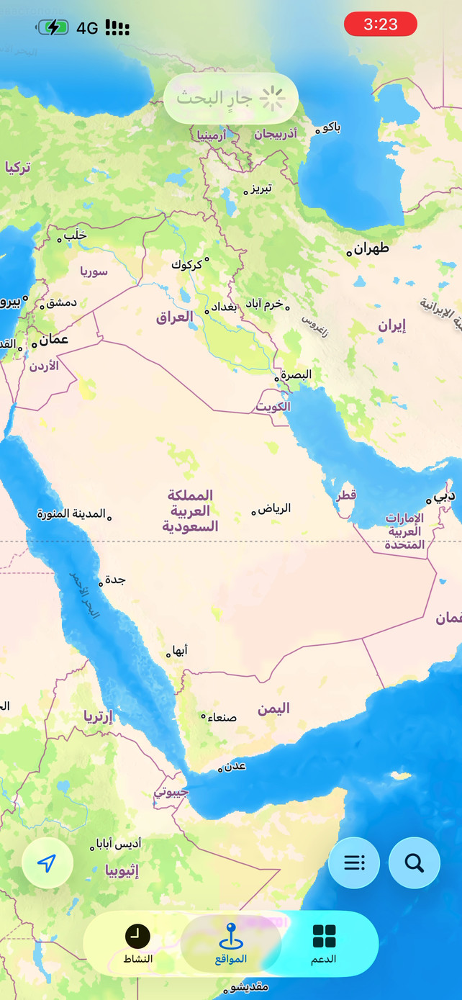

- خريطة Apple ملء الشاشة، بلا عنوان كبير.
- في الأعلى وسط: كبسولة زجاجية «جار البحث» مع مؤشر دوران.
- أسفل اليسار: زر دائري أبيض لموقعك (أيقونة سهم اتجاه). أسفل اليمين: زرّان دائريان أبيضان منفصلان (قائمة، وبحث)، بظل واضح.
- البار السفلي يطفو فوق الخريطة زجاجياً، وتبويب المواقع محدد.

### 9.5 تبويب النشاط — حالة الفراغ

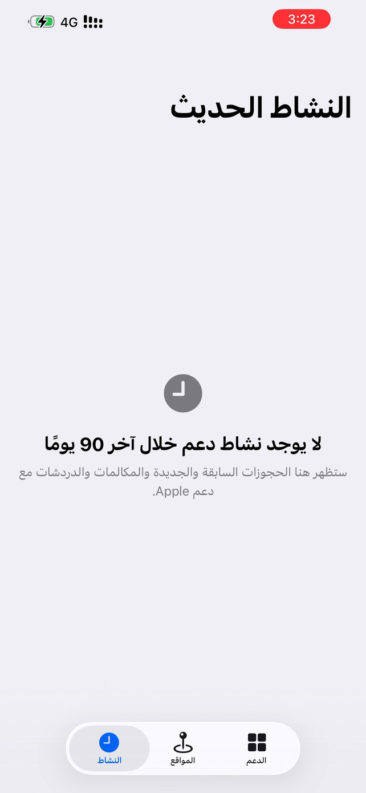

- خلفية `#F0EFF5`، عنوان كبير «النشاط الحديث».
- في وسط الشاشة: دائرة رمادية `#7A797F` وفيها أيقونة ساعة بقصّة (template)، ثم عنوان عريض «لا يوجد نشاط دعم خلال آخر 90 يومًا»، ثم شرح رمادي من سطرين يوضح أن الحجوزات والمكالمات والدردشات ستظهر هنا.
- لا رسوم معقّدة ولا أزرار دعوة لإجراء في هذه الحالة.

### 9.6 ورقة «مزيد من المنتجات»

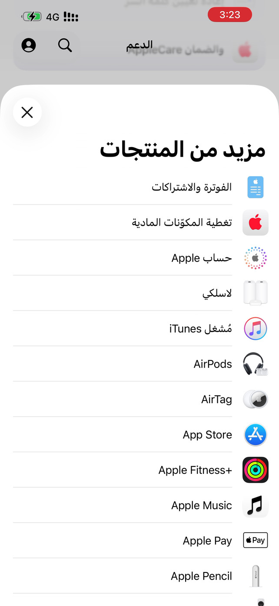

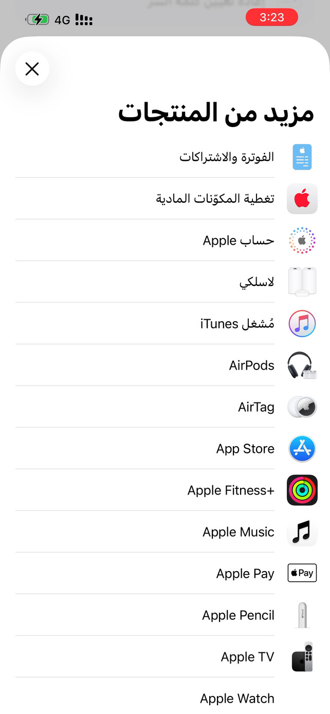

- تُفتح كـ modal sheet: الخلفية تُصغَّر (~95%) وتُعتم ويظهر انحناء زواياها، والورقة تنزلق من الأسفل بنصف قطر علوي كبير. **لا يوجد شريط سحب (grabber)**.
- زر X دائري أعلى **اليسار**. عنوان كبير يمين. قائمة طويلة من المنتجات والخدمات، أيقونة يميناً، بلا سهم كشف.

### 9.7 ورقة «خدماتي» (تحميل تدريجي للأيقونات)

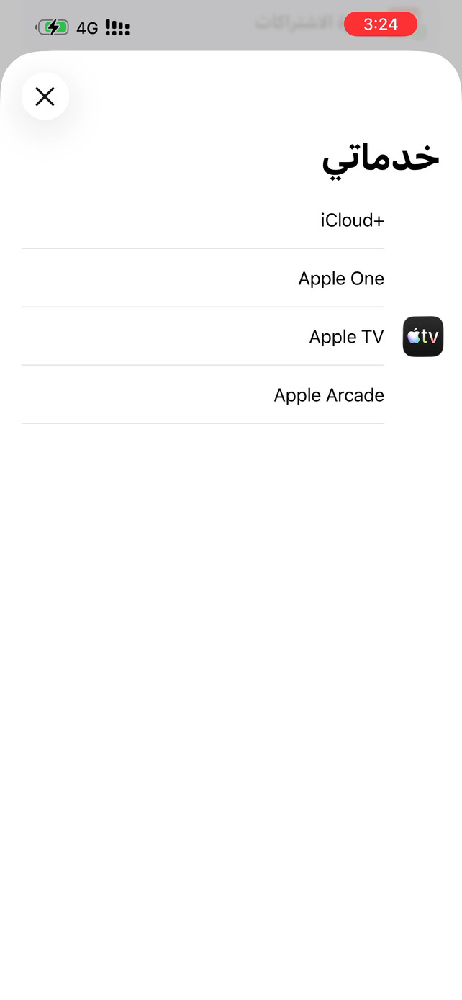

خلفية بيضاء، عنوان كبير، قائمة بسيطة. في هذه اللقطة يظهر أن أيقونات بعض الصفوف لم تصل بعد (iCloud+ وApple One وApple Arcade بلا أيقونة، بينما Apple TV ظهرت). هذا مقبول كحالة تحميل: النص أولاً ثم الأيقونات. لا تترك الصفحة فارغة إذا كانت الأسماء جاهزة.

### 9.8 ورقة «التحقق من التغطية»

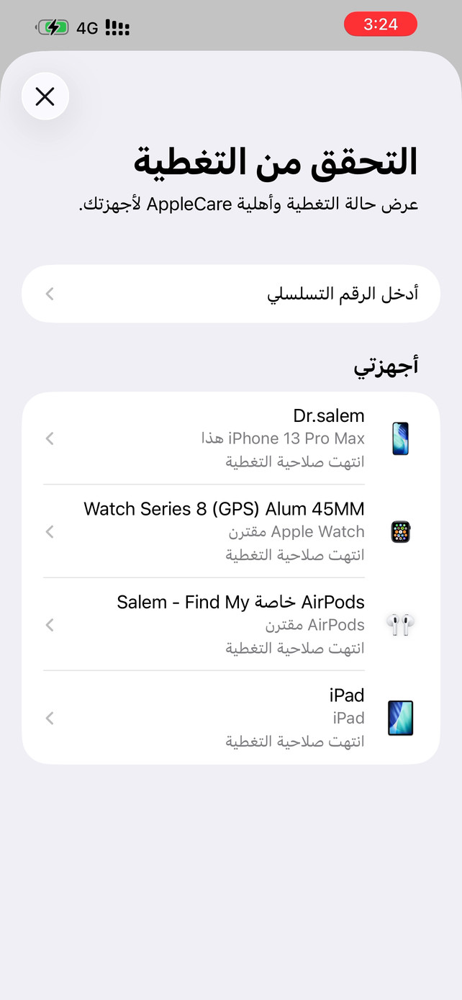

- خلفية مجمّعة `#F0EFF5`. عنوان كبير وشرح رمادي تحته.
- حقل بحث/إدخال على شكل كبسولة بيضاء: نص العنصر النائب «أدخل الرقم التسلسلي» يميناً، وسهم يساراً.
- قسم «أجهزتي»: بطاقة بيضاء مجمّعة، صورة الجهاز يميناً، الاسم والشروح (ومنها «انتهت صلاحية التغطية»)، وسهم يساراً.
- تجاهل أي بيانات شخصية في الصورة واستبدلها بعينات وهمية.

### 9.9 ورقة الاشتراكات

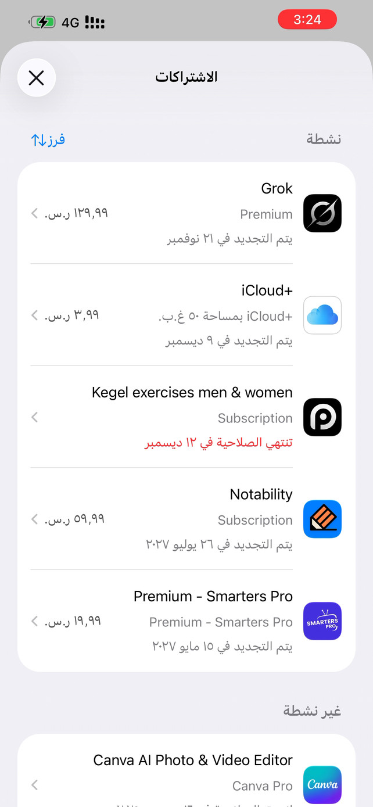

- عنوان صغير في الوسط «الاشتراكات» (ليس large title هنا)، وX يساراً.
- رأس القسم: «نشطة» يميناً، و«فرز» مع أيقونة باللون الأزرق يساراً.
- صفوف مجمّعة: أيقونة التطبيق، الاسم، وصف قصير، تاريخ التجديد الرمادي (أو أحمر `#EF3438` إن كانت الصلاحية تنتهي قريباً)، السعر مع السهم يساراً.
- قسم «غير نشطة» أسفلها في مجموعة منفصلة.
- قبل ظهور القائمة قد تُعرض الورقة بيضاء وعنوانها فقط لجزء من الثانية (حالة تحميل بلا هيكل عظمي ظاهر في هذا المقطع).

### 9.10 ورقة «أجهزتي»

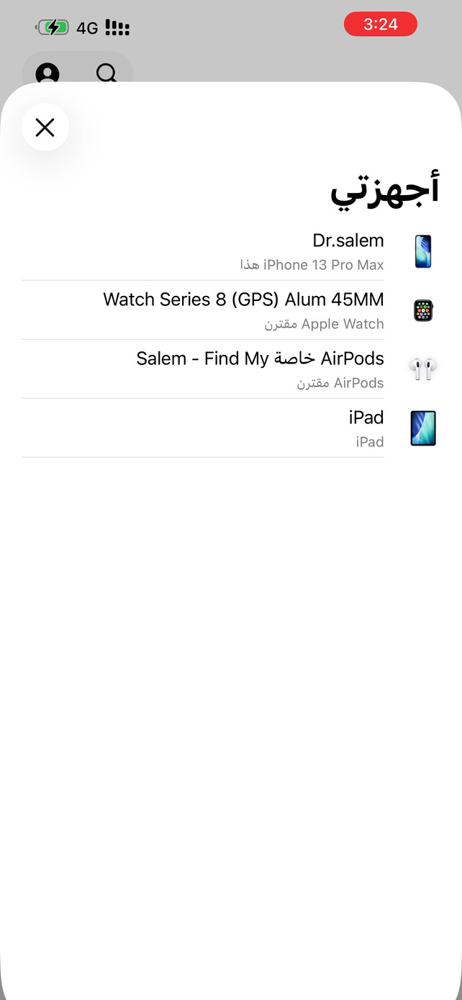

ورقة بيضاء بعنوان كبير، X يساراً، وقائمة الأجهزة مع الرسمة الحقيقية يميناً والاسم والشرح، وفواصل شعرية. بلا أسهم كشف في هذه القائمة.

### 9.11 صفحة تفاصيل الجهاز (Push) — AirPods وiPhone

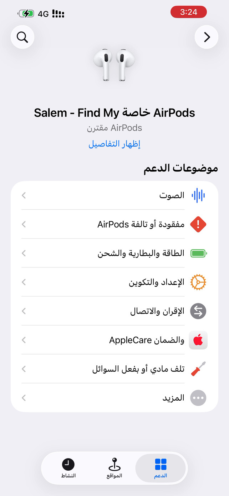

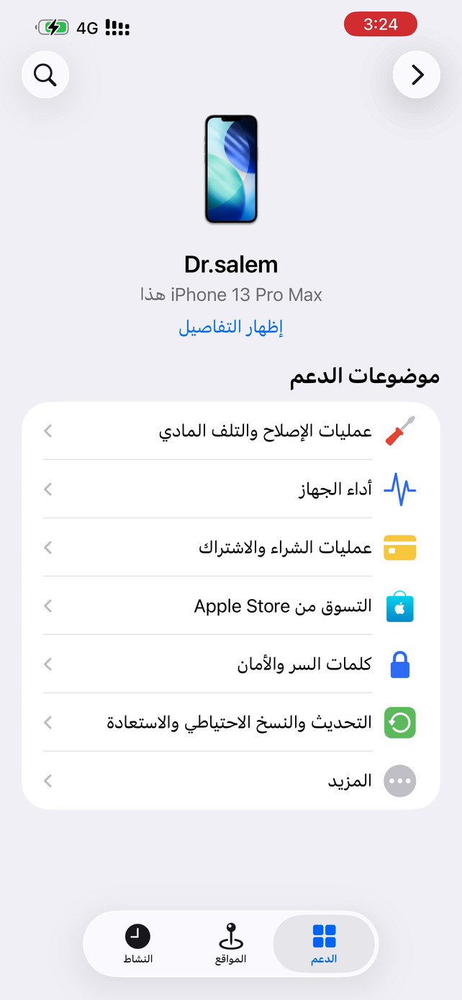

هذه **صفحة مدفوعة (push)** وليست ورقة: البار السفلي يبقى ظاهراً، وزر الرجوع الدائري يميناً، والبحث يساراً.

- خلفية `#F0EFF5`.
- في الأعلى رسمة المنتج كبيرة وواضحة على الخلفية المحايدة.
- الاسم بالأسود العريض، سطر رمادي تحته («مقترن» أو «هذا iPhone …»).
- زر نصي أزرق «إظهار التفاصيل» (tinted text button، ليس زراً ممتلئاً).
- قسم «موضوعات الدعم»: بطاقة بيضاء مجمّعة، أيقونة ملونة يميناً، عنوان الموضوع، وسهم يساراً. آخر صف «المزيد» بأيقونة نقاط.

### 9.12 ورقة موضوعات الإصلاح

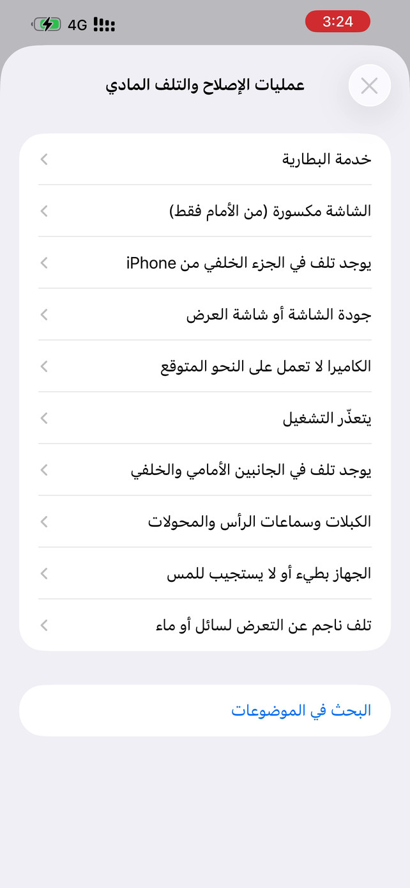

ورقة بخلفية مجمّعة، عنوان في الوسط، وزر X في هذه الشاشة على **اليمين**. قائمة موضوعات نصية داخل بطاقة بيضاء (بلا أيقونات)، وأسفلها كبسولة بيضاء بعرض البطاقة «البحث في الموضوعات» بنص أزرق.

### 9.13 الملف الشخصي

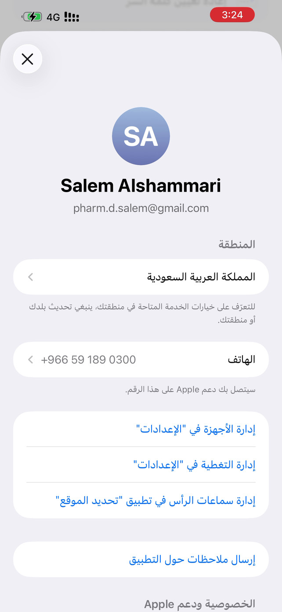

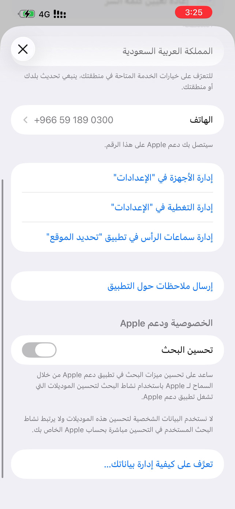

- ورقة بخلفية مجمّعة، X أعلى اليسار.
- أفاتار دائري بتدرج أزرق رمادي وأحرف اسم مختصرة باللون الأبيض، ثم الاسم العريض والبريد الرمادي.
- صفوف كبسولية بيضاء للمنطقة والهاتف، مع نص مساعدة رمادي تحتها.
- مجموعة روابط زرقاء («إدارة الأجهزة في الإعدادات» وغيرها)، وكرت منفصل «إرسال ملاحظات حول التطبيق».
- قسم «الخصوصية ودعم Apple»: صف أبيض فيه مفتاح تبديل iOS قياسي (مغلق هنا) على اليسار وتسمية «تحسين البحث» يميناً، ثم فقرات شرح رمادية، ثم رابط أزرق لإدارة البيانات.
- استخدم بيانات وهمية. في المقطع لم تظهر نافذة تنبيه (UIAlert) فوق هذه الشاشة؛ ما يظهر هو المفتاح والنصوص.

### 9.14 ورقة تحسين البحث

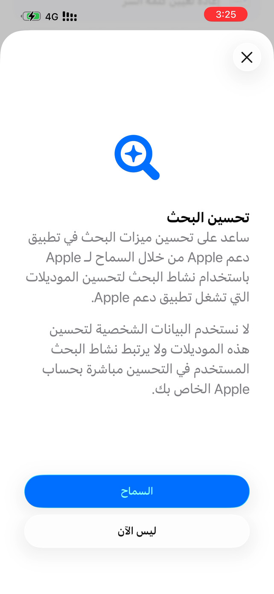

- ورقة بيضاء، X أعلى **اليمين**.
- أيقونة كبيرة زرقاء (عدسة مع لمعة) في الوسط، عنوان عريض، وفقرتا شرح رماديتان.
- زر أساسي كبسولي أزرق `#006EFE` بنص أبيض «السماح».
- تحته زر ثانوي كبسولي أبيض بنص أسود «ليس الآن».

### 9.15 ورقة البحث مع لوحة المفاتيح

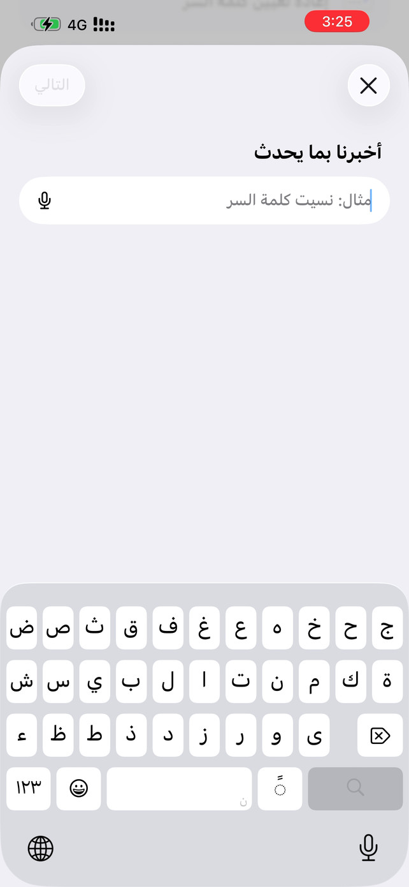

- خلفية مجمّعة، X يميناً، وكبسولة صغيرة «التالي» يساراً (تبدو غير نشطة قبل الكتابة).
- عنوان «أخبرنا بما يحدث»، ثم حقل كبسولي أبيض: نص العنصر النائب الرمادي «مثال: نسيت كلمة السر» يميناً، وأيقونة ميكروفون يساراً، مع مؤشر إدخال أزرق.
- لوحة مفاتيح iOS العربية النظامية تُفتح من الأسفل.

---

## 10. الحركة والتفاعل

### ضغط الكرت

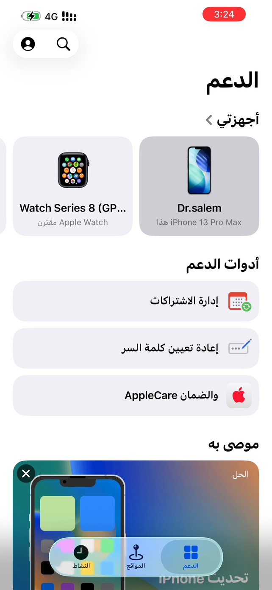

- عند الضغط على كرت جهاز: يتغيّر لون التعبئة من `#F0EFF5` إلى `#CECDD3` (تغميق متساوٍ يقارب طبقة أسود بشفافية 14%).
- في اللقطة الملتقطة أثناء الضغط **لم يُ قس تغيّر في أبعاد الكرت**. سلوك iOS المتوقع (ويُفضَّل تطبيقه) هو تصغير خفيف إلى حوالي **0.96** مع رجوع بنابض (spring) بعد رفع الإصبع.
- صفوف القوائم تأخذ تظليلاً رمادياً لحظياً عند اللمس ثم تزول.

### فتح الورقة (Sheet)

انظر `images/18-sheet-opening.jpg` وبداية فتح الملف الشخصي (الخلفية تُصغَّر ويظهر أسفل الورقة صاعداً).

- المدة التقريبية **~400ms**.
- الخلفية تُصغَّل إلى نحو **95%** وتُعتم، وتظهر زواياها العلوية مدورة.
- الورقة تدخل من الأسفل. الإغلاق: سحب إلى الأسفل أو زر X. لا تضع grabber في أعلى الورقة.

### الانتقال الأمامي (Push) في RTL

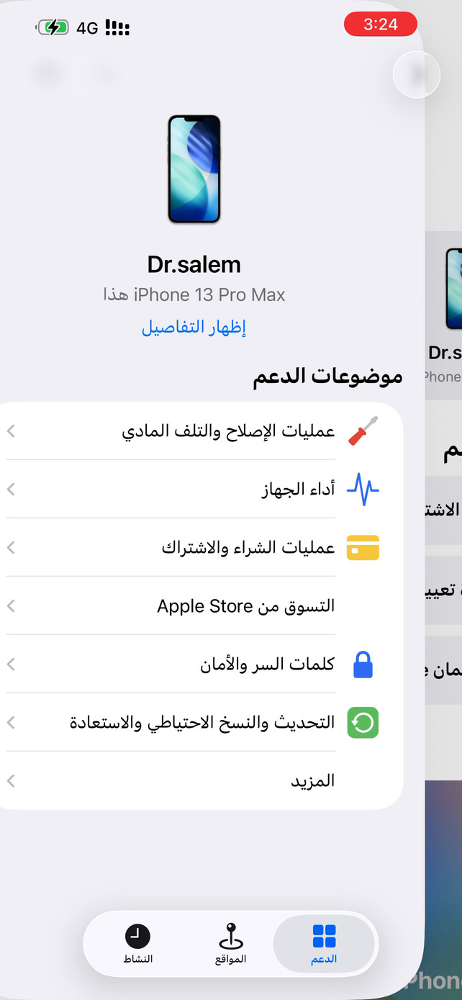

- الصفحة الجديدة تدخل **من اليسار**. الصفحة السابقة تخرج نحو اليمين. المدة التقريبية **~350ms**.
- هذا عكس اتجاه LTR. لا تعكسه بالخطأ.

### الرجوع بالسحب من الحافة اليمنى

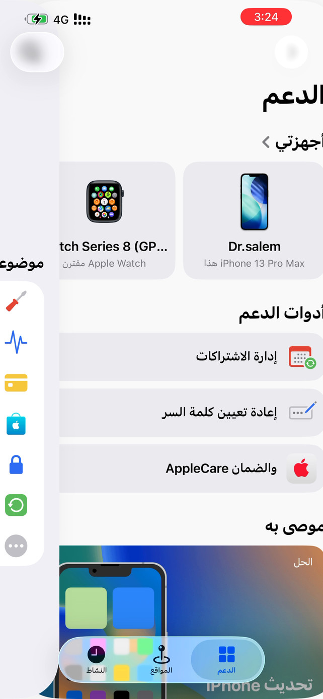

- إيماءة الرجوع تبدأ من **الحافة اليمنى** للشاشة (RTL).
- الصفحة الحالية تتبع الإصبع نحو اليسار، والصفحة السابقة مكشوفة من اليمين تحتها. الإيماءة تفاعلية (يمكن إلغاء السحب).
- يمكن أيضاً الرجوع من الزر الدائري (السهم) أعلى اليمين.

### أخرى

- ارتداد مطاطي (rubber-band) عند نهاية التمرير.
- التمرير الأفقي في دوّارات الأجهزة والمنتجات مع إطلالة (peek) للكرت التالي.
- مؤشرات التحميل: دائرة مروحية رمادية مع نص مثل «جار البحث» أو «يجري التحقق من وجود تحديثات…».
- في المقطع، الانتقال إلى «تحديث البرامج» خرج إلى تطبيق **الإعدادات** النظامي؛ لا تعتبر شاشات Settings جزءاً من نظام تصميم دعم Apple إلا إذا طُلب دمج عميق.

---

## 11. حالات التحميل والفراغ

- الإطلاق: الهيكل (العنوان + البار) يظهر قبل المحتوى.
- الخريطة: بلاط شبكة فاتح أولاً، ثم القطع، مع كبسولة «جار البحث».
- النشاط: حالة فراغ هادئة (أيقونة + عنوان + شرح)، بلا أزرار إضافية.
- خدماتي: الأسماء قد تظهر قبل الأيقونات.
- الاشتراكات: ورقة بيضاء بالعنوان وزر الإغلاق للحظات قبل وصول الصفوف (لم يظهر هيكل عظمي skeleton في هذا المقطع).
- التحقق من التحديث: مؤشر دوران في وسط الصفحة مع نص رمادي (هذا كان داخل مسار إعدادات النظام في المقطع).

---

## 12. دعم RTL — قواعد ملزمة

- الاتجاه العام من اليمين إلى اليسار.
- العنوان الكبير وعناوين الأقسام على اليمين.
- الأيقونة في جهة **البداية** (اليمين)، والنص بعدها نحو اليسار، وسهم الكشف في جهة **النهاية** (اليسار) ويشير لليسار `<`.
- كبسولة الحساب/البحث في أعلى **اليسار** (جهة النهاية)، لتوازن العنوان الكبير يميناً.
- في صفحات التفاصيل: زر الرجوع يميناً (السهم يشير لليمين أو إلى اتجاه الرجوع RTL)، والبحث يساراً.
- موقع زر X في الأوراق: في الأوراق ذات العنوان الكبير (مزيد من المنتجات، خدماتي، التغطية، الاشتراكات، أجهزتي، الملف الشخصي) يكون عادة أعلى **اليسار**. في أوراق أخرى (تحسين البحث، البحث، موضوعات الإصلاح) ظهر أعلى **اليمين**. حافظ على الاتساق داخل كل نمط، ولا تخلط النمطين في الشاشة الواحدة.
- الدفع الأمامي من اليسار، والرجوع بالسحب من الحافة اليمنى.
- الدوّارات الأفقية تبدأ من اليمين، والكرت التالي يطل من اليسار.

---

## 13. قواعد يجب الالتزام بها

- استخدم خلفية بيضاء للرئيسية الرمادية المجموعة لصفحات التفاصيل والأوراق المجمّعة؛ لا تخلط النمطين في الشاشة الواحدة بلا سبب.
- الكروت على الرئيسية رمادية بلا ظل وبلا حدود ثقيلة.
- أدوات الدعم كروت مستقلة، ليست قائمة واحدة، وبلا أسهم كشف.
- البار السفلي كبسولة زجاجية عائمة بثلاث تبويبات، مع تظليل رمادي خلف المحدد ولون أزرق لأيقونته ونصه.
- كبسولة الحساب والبحث ثابتة أثناء التمرير.
- لا تضع grabber على الأوراق.
- فرّق بين رسمة المنتج الحقيقية وأيقونات SF Symbols وأيقونات التطبيقات الملونة.
- زر «إظهار التفاصيل» نص أزرق، ليس زراً ممتلئاً.
- الزر الأساسي الممتلئ للأفعال الحاسمة فقط (مثل «السماح»).
- حالة الفراغ هادئة ومركّزية: أيقونة رمادية، عنوان، شرح.
- حافظ على المسافات ~20pt والقياس 17/22/34.
- كل النصوص العربية محاذاة يمين، وكل الحركة متوافقة مع RTL.
- تجاهل مؤشر التسجيل الأحمر في اللقطات، واستبدل أي بيانات شخصية بعينات وهمية.

---

## 14. أشياء يجب تجنبها

- لا تقلّد شعار Apple أو تنسخ نصوص الدعم الحرفية لأغراض نشر منتجك؛ انقل **النظام البصري والحركي فقط**.
- لا تستخدم شريط تبويبات ملتصقاً بعرض الشاشة بالكامل على طريقة iOS القديمة إذا كان الهدف مطابقة هذا الإصدار (البار هنا كبسولة عائمة).
- لا تضف ظلالاً أو حدوداً على كروت المحتوى.
- لا تجعل أدوات الدعم قائمة مجمّعة بسهم على كل صف.
- لا تستخدم ألواناً فاقعة في الخلفيات، ولا وضعاً داكناً ما لم يُطلب.
- لا تفتح الصفحات الجديدة من اليمين في الواجهة العربية.
- لا تضف شريط سحب للأوراق، ولا تلغِ تصغير الخلفية عند فتح الورقة.
- لا تستبدل رسوم الأجهزة بأيقونات مسطحة، ولا تستبدل SF Symbols برسوم عشوائية.
- لا تضع زر «إظهار التفاصيل» كزر أزرق ممتلئ.
- لا تُظهر هيكل تحميل مزخرف إذا كان المحتوى النصي جاهزاً (الأيقونات قد تتأخر وحدها).
- لا تنسخ رقم الهاتف أو البريد أو الاسم من الصور.

---

## 15. ملخص سريع للتنفيذ

ابنِ الواجهة كنظام iOS عربي RTL بروح iOS 26 Liquid Glass: رئيسية بيضاء بكروت رمادية مدورة بلا ظل، تفاصيل وأوراق بأسلوب grouped `#F0EFF5` وبطاقات بيضاء، بار سفلي زجاجي عائم بثلاث تبويبات (المحدد أزرق مع كبسولة رمادية)، وهيدر فيه عنوان كبير يمين وكبسولة حساب/بحث عائمة يساراً تثبت مع التمرير. الأوراق تصعد من الأسفل مع تصغير وتعتم الخلفية، والصفحات المدفوعة تدخل من اليسار ويُرجع منها بالسحب من اليمين. الضغط يغمّق الكرت (~14% أسود، مع spring إلى 0.96 إن أمكن). الخط SF Arabic / SF Pro، والأزرق المقاس قريب من `#006EFE` / `#0F6EFC`.

---

## English core prompt (paste this with the images)

You are an iOS interface designer/engineer (iOS 26, Liquid Glass). Recreate the **visual and interaction system** of the Apple Support app (light mode, Arabic RTL, 428pt-wide iPhone) from the attached screenshots. Do not copy Apple’s brand, marketing copy, or any personal data in the photos. Ignore the red screen-recording pill in the status bar.

**Surfaces:** Support-tab home is pure white `#FFFFFF` with unshadowed light-gray cards `#F0EFF5` (corner radius ~18pt). Activity, device-detail, and most settings-style sheets use grouped background `#F0EFF5` with white inset-grouped lists. Side inset ~20pt; 10pt gutters; tool-row height 64pt; device cards ~189×156pt; more-products row height ~54pt; hairline separators `#E5E5E5`. Modal sheets have very large top radii (~36–40pt) and **no grabber**.

**Type:** SF Arabic + SF Pro. Large title ~34pt heavy, section headers ~22pt bold, body 17pt, captions 13–15pt in secondary `#7A797F`. Primary text is `#000000`.

**Color (sampled from the recording; may be a slight encode-shift from true iOS tokens):** solid CTA `#006EFE`, tinted links `#0F6EFC`, selected-tab icon `#0063F5`, expiry red `#EF3438`, pressed card `#CECDD3` (~14% black overlay on `#F0EFF5`). True system tokens are likely `#007AFF`, `#8E8E93`, `#F2F2F7`, `#FF3B30` if you are on-device.

**Chrome:** A floating Liquid Glass tab bar (3 tabs: Support, Locations, Activity) sits above the home indicator, not edge-to-edge. Unselected tabs are filled black SF Symbols + black labels; the selected tab is blue and sits on a gray pill `#E6E5E9` inside the bar. The bar is translucent (`backdrop-filter`) — especially obvious over the map. On Support home, profile + search sit together in a floating white capsule at the top-**leading-opposite** side (top-left in RTL) with a soft shadow; it stays pinned while the large title «الدعم» collapses into the nav bar on scroll.

**Cards & lists:** Support tools are *separate* rounded cards, icon on the right (RTL leading), **no chevrons**. Devices and “more products” are horizontal carousels with a peek of the next card. Device renders are photoreal product shots, not flat icons. “Show Details” is a **tinted text button**, not a filled button. Recommended is a full-width gradient image card with a small X in a dark circle and a “الحل” label.

**Motion (RTL):** Tabs switch instantly. Modal sheets slide up in ~400ms; the background scales to ~95% and dims. Push: the new view enters **from the left**; interactive pop is a swipe **from the right edge** (see images 18–20). Card press darkens the fill (image 21); apply a light spring scale to ~0.96 on press even though scale wasn’t measurable in the captured frame. Scroll has rubber-band bounce.

**States:** Empty Activity = gray clock-in-circle + bold title + gray two-line caption, no extra CTA. Loading may show titles before icons (My Services) or a blank titled sheet before rows (Subscriptions). Map shows a light tile grid + a “جار البحث” glass pill and floating round white buttons.

**RTL rules:** icons on the right, chevrons on the left pointing left; large titles on the right; back control on the top-right; forward push from the left; back swipe from the right. Close (X) is top-left on large-title sheets, top-right on some compact/search sheets — stay consistent within each pattern.

Build to these screenshots, not to a generic iOS 16 tab bar or Material look.
